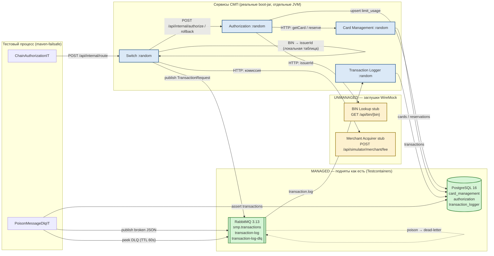

# Практика 6. Интеграционное тестирование с PostgreSQL и RabbitMQ в Testcontainers

> **Модуль**: 6 — Интеграционное тестирование с БД в контейнерах
> **Артефакт**: интеграционные тесты (`*IT`) + настоящий отчёт
> **Ветка**: `practice-6`
> **Автор**: Кулакова Юлия
> **Прогон**: `mvn -f services/pom.xml -Pintegration-tests verify` (или `make mvn-it`), CI job `integration-tests` — два прогона подряд

---

## 1. Граница уровней: что осталось в unit-тестах, а что переехало в интеграционные

### Что осталось на unit-уровне (практика 4)

| Проверка | Где | Почему остаётся юнитом |
|---|---|---|
| Бизнес-правила `AuthServiceImpl`: порядок проверок (карта найдена → статус → срок → баланс → лимиты → резерв) | [`AuthServiceImplTest`](../../services/authorization/src/test/java/com/processing/authorization/services/AuthServiceImplTest.java) | Логика ветвления не зависит от СУБД и брокера; зависимости мокаются, прогон мгновенный |
| Ветки отказа `DeclineOutcome` (коды 05/14/51/54/61/96) | [`AuthServiceImplTest`](../../services/authorization/src/test/java/com/processing/authorization/services/AuthServiceImplTest.java) | Чистое решение по входным данным, никакого ввода-вывода |
| Валидация PAN по Луну, генерация PAN, `Card.withData/deleted/withReservation` | [`LuhnValidatorTest`](../../services/card-management/src/test/java/com/processing/cardmanagement/services/LuhnValidatorTest.java), [`CardTest`](../../services/card-management/src/test/java/com/processing/cardmanagement/models/CardTest.java), [`ReservationTest`](../../services/card-management/src/test/java/com/processing/cardmanagement/models/ReservationTest.java) | Арифметика и инварианты домена |
| Нормализация `terminalId`/`merchantId`, таблица BIN → issuerId | [`AuthorizationRequestNormalizerTest`](../../services/switch/src/test/java/com/processing/service/AuthorizationRequestNormalizerTest.java), [`RoutingServiceTest`](../../services/switch/src/test/java/com/processing/service/RoutingServiceTest.java) | Детерминированное преобразование строк |
| Ретраи и circuit breaker на `RestClient` | [`RetryFactoryTest`](../../services/switch/src/test/java/com/processing/config/RetryFactoryTest.java), [`CircuitBreakerFactoryTest`](../../services/switch/src/test/java/com/processing/config/CircuitBreakerFactoryTest.java), [`AuthorizationClientTest`](../../services/switch/src/test/java/com/processing/service/AuthorizationClientTest.java) | Проверяется конфигурация и поведение обёрток, сеть имитируется моками |

### Что переехало в интеграционные (`*IT`)

| Проверка | Класс | Почему без реальной инфраструктуры не проверить |
|---|---|---|
| Round-trip карты через `ON CONFLICT`-схему, типы колонок `NUMERIC(19)`, `YearMonth ↔ VARCHAR(4)` | `CardRepositoryIT` | Маппинг проверяется только реальным драйвером и реальным диалектом |
| Частичный уникальный индекс `uk_cards_pan ... WHERE status != 'DELETED'` (V5.8) | `CardRepositoryIT` | Ограничение живёт в DDL PostgreSQL, а не в Java-коде |
| Применение миграций V5.1–V5.8 на пустой БД | `CardRepositoryIT` | Flyway исполняет SQL против СУБД; «успешный старт» и есть проверка |
| Атомарный `upsertLimitUsage` (`INSERT ... ON CONFLICT (pan, usage_date) DO UPDATE ... WHERE`) | `LimitUsageRepositoryIT` | Нативный SQL с диалектной конструкцией; мок возвращает `1` всегда и потому не ловит ни накопление, ни отказ по лимиту |
| Настоящий сквозной проход Switch → Authorization → Card Management → Transaction Logger с записью в три БД | `ChainAuthorizationIT` | Эффект распределён по процессам и БД; проверяется «изнутри», а не по HTTP-коду |
| Poison message → DLQ, живучесть листенера | `PoisonMessageDlqIT` | Поведение брокера и `ConditionalRejectingErrorHandler` — только на реальном RabbitMQ |

### Обязательный пример: `upsertLimitUsage`

В практике 4 метод `LimitUsageRepository.upsertLimitUsage(...)` мокался в [`AuthServiceImplTest`](../../services/authorization/src/test/java/com/processing/authorization/services/AuthServiceImplTest.java):

```java
when(limitUsageRepository.upsertLimitUsage(any(), any(), any(), any(), any())).thenReturn(1);
```

Такой мок проверяет только то, что `AuthServiceImpl` **умеет читать возвращаемое значение** `1`/`0`. Он не отвечает ни на один вопрос, ради которого метод существует:

- действительно ли `ON CONFLICT (pan, usage_date)` не создаёт вторую строку;
- растут ли `daily_amount` и `monthly_amount` атомарно;
- отклонится ли операция, когда `daily_amount + amount > daily_limit`;
- подхватывается ли месячная сумма из предыдущей записи месяца.

В `LimitUsageRepositoryIT` тот же метод вызывается **настоящим** — против реального PostgreSQL, и все четыре вопроса проверяются утверждениями на состоянии таблицы:

| Тест | Что доказывает |
|---|---|
| `shouldInsertOnFirstUpsert` | первый вызов возвращает `1`, строка одна, суммы равны сумме операции |
| `shouldAccumulateOnSecondUpsert` | второй вызов возвращает `1`, строк по-прежнему одна, суммы накоплены (300 → 500) |
| `shouldRejectUpsertExceedingDailyLimit` | при 700 + 400 > 1000 возвращается `0`, сумма остаётся **700** |
| `shouldRejectUpsertExceedingMonthlyLimit` | отказ по месячному лимиту при «помещающемся» дневном |
| `shouldCarryMonthlyAmountAcrossDays` | новая дата в том же месяце даёт месячную сумму 250 + 150 = 400 двумя строками |

### Почему H2 это не поймал бы

Демонстрация из части 2 практики — «зелёный тест на H2 ≠ совместимость с продовой СУБД». Ниже разбор по каждому пункту, потому что именно эти расхождения и составляют ценность `*IT`.

**Механика H2-прогона.** Чтобы вообще запустить тесты на H2, приходится снять `@AutoConfigureTestDatabase(replace = NONE)`, добавить `@TestPropertySource` с `spring.flyway.enabled=false`, `spring.jpa.hibernate.ddl-auto=create-drop` и `H2Dialect`. Причина: миграции Card Management PostgreSQL-специфичны — V5.8 содержит `CREATE UNIQUE INDEX uk_cards_pan ON cards (pan) WHERE cards.status != 'DELETED'`, а H2 частичные индексы (`CREATE INDEX ... WHERE`) не поддерживает. То есть на H2 Flyway не проходит, схему генерирует Hibernate из `@Entity`, и прогон идёт **не на продовой схеме**.

| Проверка | На PostgreSQL (`CardRepositoryIT`) | На H2 | Что это значит |
|---|:---:|:---:|---|
| Round-trip карты | ✅ | ✅ | Маппинг полей переносим — этот тест на H2 «зелёный» и **ничего не доказывает** про прод |
| Дубликат активной карты отклоняется | ✅ | ✅ | Тоже «зелёный», но по другой причине: Hibernate создаёт **обычный** `unique (pan)` из `@Column(unique = true)`, а не частичный индекс |
| PAN удалённой карты можно переиспользовать | ✅ | ❌ **падает** | Главное расхождение. На H2 обычный `unique (pan)` запрещает вторую строку с тем же PAN независимо от статуса, поэтому сценарий «удалили → выпустили заново» невоспроизводим. На PostgreSQL частичный индекс V5.8 разрешает две строки: одну `DELETED`, одну `ACTIVE` |
| Миграции V5.1–V5.8 применились | ✅ | ❌ **падает** | На H2 Flyway выключен, `flyway_schema_history` пуст, частичного индекса в схеме нет. Проверка `pg_indexes ... indexdef LIKE '%status%'` тоже неприменима |

Итог по заданию 1: H2 скрывает ровно то, ради чего писался тест — **частичный индекс** и **применимость миграций**. Из четырёх проверок H2 проходит две, причём проходит их по неверной причине. `CardRepositoryIT` поэтому жёстко зафиксирован на `postgres:16-alpine` и `ddl-auto=validate` (схема — только из миграций).

**Про `LimitUsageRepositoryIT` на H2 — ещё жёстче.** Нативный запрос использует `INSERT ... ON CONFLICT (pan, usage_date) DO UPDATE` и `gen_random_uuid()`. `ON CONFLICT` — конструкция PostgreSQL; H2 её не поддерживает, поэтому не проходит уже **первый** тест задания 2. Замена на `MERGE`/`ON DUPLICATE KEY` — это переписывание продового запроса, то есть проверка другого кода. Вывод: диалектные запросы тестируются только на том же диалекте.

**Как воспроизвести эксперимент локально (без коммита класса на H2).** Временно в `CardRepositoryIT`: убрать `replace = NONE`, добавить
`@TestPropertySource(properties = {"spring.flyway.enabled=false", "spring.jpa.hibernate.ddl-auto=create-drop", "spring.jpa.database-platform=org.hibernate.dialect.H2Dialect"})`
и `com.h2database:h2` в scope `test`; прогнать и записать сообщения об ошибках. Ожидаемая картина: `shouldPersistAndReadCardRoundTrip` и `shouldRejectSecondActiveCardWithSamePan` — зелёные, `shouldAllowReusingPanOfDeletedCard` — падение на `Unique index or primary key violation`, `shouldApplyAllFlywayMigrations` — падение на пустом списке версий. После эксперимента конфигурация возвращается к PostgreSQL, класс на H2 в репозиторий не попадает.

---

## 2. Persistence-checklist по своим тестам

| Пункт | Покрыт | Где именно |
|---|:---:|---|
| **Round-trip** (Java → SQL → Java без искажений) | ✅ | `CardRepositoryIT.shouldPersistAndReadCardRoundTrip` — сверяются PAN, BIN, имя, `YearMonth` (формат `MMyy` в `VARCHAR(4)`), статус, валюта, три `NUMERIC(19)`, issuerId, `createdAt` |
| **Ограничения целостности** | ✅ | `shouldRejectSecondActiveCardWithSamePan` → `PanCollisionException` (обёртка над `DataIntegrityViolationException`), `shouldAllowReusingPanOfDeletedCard` → частичный индекс V5.8 разрешает пару `DELETED` + `ACTIVE` |
| **Миграции на чистой БД** | ✅ | `shouldApplyAllFlywayMigrations` — проверяет наличие версий `5.1…5.8` в `flyway_schema_history` и существование частичного индекса в `pg_indexes`; сам факт старта контекста уже доказывает, что миграции применились |
| **Диалектные запросы** | ✅ | `LimitUsageRepositoryIT` — весь класс: `INSERT ... ON CONFLICT`, `DATE_TRUNC`, `gen_random_uuid()`; 5 тестов, включая границы лимитов |
| **Транзакционность** | ✅ | Правило трёх транзакций: `@Transactional(propagation = NOT_SUPPORTED)` на классах, нативный upsert выполняется через отдельный `TransactionTemplate`; rollback теста не маскирует ошибки персистентности |
| **Идемпотентность/уникальность бизнес-ключей** | ✅ | `CardRepositoryIT.uniquePan()` (BIN + счётчик + Luhn), `ChainAuthorizationIT.uniqueStan()`, RRN генерируется сервисом через `rrn_seq` |
| **Асинхронные эффекты** | ✅ | `ChainAuthorizationIT` (Awaitility 30 c / 200 мс), `PoisonMessageDlqIT` (Awaitility 10 c / 50 мс и 30 c / 200 мс) |

Отдельно про схему Authorization: она создаётся Hibernate (`ddl-auto: update`), Flyway управляет только последовательностью `rrn_seq` (`V3.1__create_rrn_seq.sql`). Поэтому в `LimitUsageRepositoryIT` проверка миграций не ставится как отдельная цель — проверяется совместимость entity-маппинга и нативного запроса с реальной СУБД (для этого класс зафиксирован на `ddl-auto=update`, как в проде).

---

## 3. Стратегия изоляции

### 3.1. Жизненный цикл контейнеров

| Уровень | Решение | Обоснование |
|---|---|---|
| `CardRepositoryIT`, `LimitUsageRepositoryIT`, `PoisonMessageDlqIT` | `static @Container`, один контейнер на класс | Старт PostgreSQL/RabbitMQ — секунды; поднимать его на каждый метод неоправданно. Per-class — баланс между скоростью и чистотой |
| `ChainAuthorizationIT` | Окружение поднимается один раз в `@BeforeAll`, закрывается в `@AfterAll` | Четыре JVM-сервиса + два контейнера + две заглушки: цена старта десятки секунд, поэтому один раз на класс |
| Масштаб на весь набор (singleton) | **Не используется** | Singleton-окружение протекает состоянием между классами: остаточные строки и сообщения делают прогон зависимым от порядка. Каждый класс владеет своим окружением и гарантированно его закрывает |

Для сквозного теста один контейнер PostgreSQL содержит **три отдельные базы** (`card_management`, `authorization`, `transaction_logger`), потому что у сервисов разные наборы миграций и общая схема смешала бы следы. Контейнер при этом один — это дешевле, чем три.

### 3.2. Очистка данных — в `@BeforeEach`

| Класс | Очистка |
|---|---|
| `CardRepositoryIT` | `TRUNCATE TABLE cards, outbox_event RESTART IDENTITY CASCADE` |
| `LimitUsageRepositoryIT` | `TRUNCATE TABLE limit_usage` |
| `ChainAuthorizationIT` | `TRUNCATE` в трёх базах (`reservation_rollbacks, reservations, cards, outbox_event`; `limit_usage`; `transactions`) + `purge` очередей `transaction-log` и `transaction-log-dlq` |
| `PoisonMessageDlqIT` | `purge` обеих очередей |

Почему `@BeforeEach`, а не `@AfterEach`: тест должен **гарантировать** чистое состояние до себя, а не надеяться, что предыдущий тест не упал на середине и успел убрать за собой. При падении `@AfterEach` не спасает — следующий тест получает грязь. Плюс очистка «до» устойчива к запуску одного метода из IDE и к повторному прогону без пересоздания контейнера (требование двойного прогона в CI).

### 3.3. Генерация уникальных ключей

| Ключ | Способ | Почему так |
|---|---|---|
| PAN | `400000` + `%010d`(nanoTime + счётчик) + контрольная цифра Луна | 16 цифр, валидный PAN, не повторяется между тестами и между прогонами; BIN `400000` есть в таблице маршрутизации Switch и в стабе BIN Lookup |
| STAN | `%06d` от `nanoTime % 1_000_000`, с защитой от совпадения двух подряд | Ровно 6 цифр по контракту `TransactionRequest`, уникален в пределах прогона |
| RRN | генерируется Authorization через `rrn_seq` (`%1d%03d%08d`, 12 знаков) | Не подделываем бизнес-ключ: он принадлежит сервису, тест лишь читает его из ответа и ищет по нему следы |
| RRN резерва в БД | берётся из ответа Switch и ищется в `reservations.rrn` | Сквозная проверка «тот же RRN во всех трёх БД» |

### 3.4. Асинхронность и детерминизм

- Только Awaitility: `await().atMost(...).pollInterval(...).untilAsserted(...)`. `Thread.sleep` в тестах нет ни одного (ожидание готовности сервиса тоже переведено на Awaitility с `ignoreExceptions`).
- Таймаут — диагноз, а не ручка: 30 c на сквозной асинхронный эффект (брокер + JPA + Flyway на холодном старте), 10 c на DLQ (ошибка конвертации — первая доставка).
- DLQ читается сразу, без пауз: у очереди `x-message-ttl = 60000`, и «подождать секундочку» сделало бы тест флаки по внешней причине. Проверка содержимого идёт через `basicGet` + `basicNack(requeue=true)`, чтобы не удалить улику до ассерта.
- Двойной прогон в CI и полный `TRUNCATE`/`purge` в `@BeforeEach` вместе закрывают требование «зелёные при запуске всего набора целиком».

---

## 4. Диаграмма цепочки задания 3: managed и unmanaged



Пояснения к границе:

- **Managed (как есть)**: PostgreSQL и RabbitMQ — их поведение (диалект, `ON CONFLICT`, индексы, dead-lettering, TTL) и есть предмет проверки, поэтому никаких in-memory подмен.
- **Unmanaged (заглушки WireMock)**: BIN Lookup и Merchant Acquirer — внешние системы вне границы СМП. Контракты стабов сняты со спецификаций: `BinLookupResponse { bin, issuerId, issuerName }` для `GET /api/bin/{bin}` и `AcquirerFeeResponse { acquirerFee }` для `POST /api/simulator/merchant/fee`.
- **Сервисы** запускаются как реальные процессы из собранных boot-jar (профиль `integration-tests` собирает их в реакторе до модуля тестов), адреса зависимостей переопределяются переменными окружения — тех же, что использует `docker-compose.yaml`. Рабочим каталогом процесса выставлен `target` сервиса, чтобы посторонний `.env` из корня репозитория не мог переопределить тестовые настройки.

---

## 5. Что сделано по заданиям и как это проверить

| Задание | Класс | Тесты | Команда |
|---|---|---|---|
| 1. Персистентность карт | [`CardRepositoryIT`](../../services/card-management/src/test/java/com/processing/cardmanagement/repositories/CardRepositoryIT.java) | round-trip, дубликат активной карты, переиспользование PAN удалённой, миграции V5.1–V5.8 | `mvn -f services/pom.xml -Pintegration-tests verify -pl card-management -am` |
| 2. Атомарный upsert лимитов | [`LimitUsageRepositoryIT`](../../services/authorization/src/test/java/com/processing/authorization/repositories/LimitUsageRepositoryIT.java) | первый upsert, накопление, граница дневного лимита, граница месячного, перенос месячной суммы | `mvn -f services/pom.xml -Pintegration-tests verify -pl authorization -am` |
| 3. Сквозной проход | [`ChainAuthorizationIT`](../../services/integration-tests/src/test/java/com/processing/integration/chain/ChainAuthorizationIT.java) | APPROVED + следы в трёх БД и в брокере; две транзакции с уникальными STAN/RRN накапливают дневной лимит | `make mvn-it` |
| 4. Poison message → DLQ | [`PoisonMessageDlqIT`](../../services/integration-tests/src/test/java/com/processing/integration/messaging/PoisonMessageDlqIT.java) | битый JSON в DLQ, основная очередь пуста, следующее валидное сообщение обработано | `make mvn-it` |

> **Соответствие контракту ТЗ.** В задании вход назван `POST /api/internal/authorize` «в Switch». В коде СМП эндпоинт Switch, принимающий транзакцию от Gateway, называется `POST /api/internal/route` ([`RouteController.routeTransaction()`](../../services/switch/src/main/java/com/processing/controller/RouteController.java:45)); `/api/internal/authorize` — это эндпоинт самого Authorization Service. Тест вызывает реальный эндпоинт Switch, то есть проверяет именно ту точку входа, через которую идёт продовый трафик.

Вспомогательная инфраструктура тестов (модуль `services/integration-tests`): `ChainEnvironment`, `ServiceProcess`, `Postgres`, `Rabbit`, `Http`, `Ports`.

> **Почему `CardRepositoryIT` и `LimitUsageRepositoryIT` лежат в своих сервисах, а `PoisonMessageDlqIT` — в `integration-tests`.** Первые два работают через `@DataJpaTest`-срез внутри Spring-контекста сервиса, поэтому им место в `services/card-management` и `services/authorization` рядом с кодом, который они проверяют. Тест DLQ проверяет брокер и листенер как единый узел: ему нужно поднять Transaction Logger отдельным процессом и работать с общими хелперами (`Rabbit`, `ServiceProcess`, `Postgres`). Дублировать эти хелперы в сервисный модуль или выносить отдельный test-support-модуль ради одного класса нерационально — поэтому он живёт в `integration-tests` рядом с хелперами, а профиль `-Pintegration-tests` всё равно запускает его в общем прогоне.

### Профиль и CI

- Профиль `-Pintegration-tests` включает модули `common, card-management, authorization, transaction-logger, switch, integration-tests` и выставляет `skipITs=false`.
- По умолчанию `skipITs=true`: лёгкий CI (`java-services`) и `make test` остаются быстрыми, Docker для них не нужен.
- Job `integration-tests` в `.github/workflows/ci.yml` выполняет `mvn -f services/pom.xml -Pintegration-tests verify` **дважды подряд** на одном runner'е; артефакты `failsafe-reports` выгружаются всегда.

---

## 6. Лист самопроверки

- [x] CI job `integration-tests` выполняет `verify` два раза подряд — оба прогона должны быть зелёными (проверка детерминизма)
- [x] Все тесты — `*IT`, выполняются maven-failsafe на фазе `verify`; из surefire исключены
- [x] PostgreSQL и RabbitMQ поднимаются Testcontainers, никаких H2/in-memory подмен (в `CardRepositoryIT` прямо стоит `replace = NONE` и `ddl-auto=validate`)
- [x] Контейнеры статические, один на класс; сквозное окружение — одно на класс, закрывается в `@AfterAll`
- [x] Очистка данных в `@BeforeEach` (`TRUNCATE ... RESTART IDENTITY CASCADE` / `purge`)
- [x] Уникальные PAN/STAN на каждый тест, RRN — от сервиса
- [x] Асинхронные проверки только через Awaitility, `Thread.sleep` в тестах отсутствует
- [x] DLQ-проверка выполнена: битый JSON в `transaction-log-dlq`, основная очередь пуста, сервис жив
- [x] Тесты рассчитаны на запуск всего набора целиком: очистка «до», никаких зависимостей от порядка
- [x] Отчёт заполнен по всем пунктам структуры (граница уровней + «почему H2 не поймал бы», persistence-checklist, стратегия изоляции, диаграмма managed/unmanaged)
